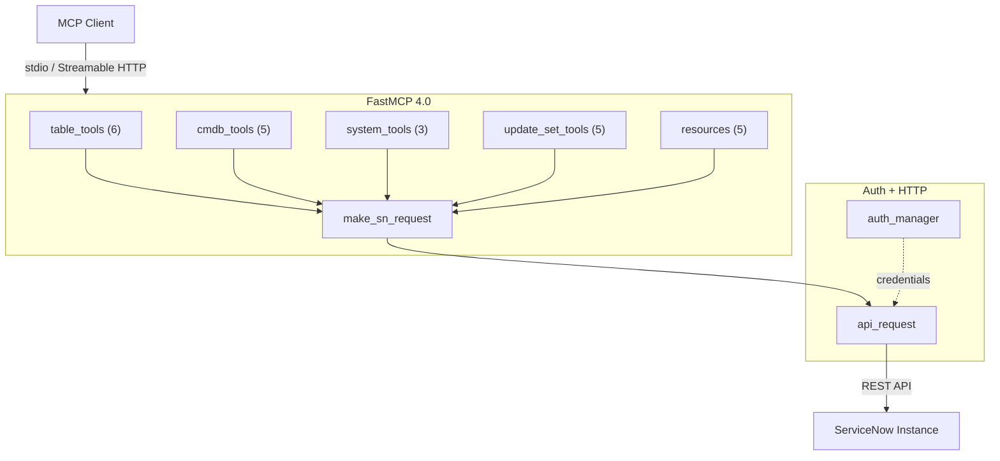

<!-- mcp-server: servicenow | tools: 19 | resources: 5 | transport: stdio,streamable-http | auth: basic,oauth,api_key | framework: fastmcp-4.0 -->
<!-- mcp-name: io.github.jschuller/mcp-server-servicenow -->

<p align="center">
  
</p>

<h1 align="center">ServiceNow MCP Server</h1>

<p align="center">
  <a href="https://pypi.org/project/mcp-server-servicenow/"></a>
  <a href="https://www.python.org/"></a>
  <a href="https://gofastmcp.com"></a>
  <a href="#available-tools"></a>
  <a href="#resources"></a>
  <a href="https://modelcontextprotocol.io"></a>
  <a href="LICENSE"></a>
  <a href="https://github.com/jschuller/mcp-server-servicenow/actions/workflows/ci.yml"></a>
  <a href="https://pypi.org/project/mcp-server-servicenow/"></a>
</p>

<p align="center">
  The developer data plane for ServiceNow in Claude Code — Table API, schema, aggregates and update sets,<br>
  on any release from Tokyo up, on PDIs, in GCC, for free. Runs alongside ServiceNow's native MCP Server.
</p>

---

`Table API` · `CMDB` · `Update Sets` · `Aggregation` · `Resources` · `Read-only mode` · `Audit log` · `OAuth 2.1+PKCE` · `Streamable HTTP` · `Claude Code Plugin` · `4 Skills`

## What This Does

This MCP server gives AI assistants the raw ServiceNow data plane: any table via the Table API, the data dictionary (with inherited fields), Stats API aggregates, CMDB classes and relationships, and update sets. 19 tools and 5 resources, with tool annotations, an optional read-only mode, table allow/deny lists, hardened encoded queries, and a JSON audit line per call.

Built with [FastMCP 4.0](https://gofastmcp.com) — speaks both the stateless MCP 2026-07-28 protocol and the legacy handshake, negotiated per connection.

## Alongside ServiceNow's native MCP Server

ServiceNow's **MCP Server Console** (Action Fabric) exposes Now Assist skills, Knowledge Graph, flows, scripted REST and playbooks as governed tools — and **excludes the Table API by design** ("cannot be converted to MCP tools regardless of configuration"). This project is the other half: the developer loop that native does not serve. ServiceNow's own CEG AI CoE guide lists `uvx mcp-server-servicenow` as its community "Path C".

| | Native MCP Server Console | This project |
|---|---|---|
| **Tool sources** | Now Assist skills, Knowledge Graph, subflows/actions, scripted REST (GET/POST/PUT), playbooks, MCP Apps | Table API CRUD, Stats API aggregates, `sys_dictionary` schema, update sets, CMDB via Table API |
| **Table API** | Excluded by design | Any table, any field |
| **Minimum release** | Zurich P9 / Australia P2 for custom tools | Tokyo+ |
| **Entitlement** | Now Assist / AI-Native SKU (docs: Prime for inbound); metered in assists | MIT, $0, your own compute |
| **PDIs / GCC** | Not available | Works |
| **Auth** | OAuth 2.0 auth-code via Machine Identity Console (JWT, no DCR) | OAuth 2.1 + PKCE proxy (DCR + CIMD), static tokens, or a service account |
| **Governance** | AI Control Tower / AI Gateway | Self-managed: `--read-only`, table allow/deny, opt-in write confirmation, audit log, tool annotations |
| **Transport** | Streamable HTTP only | stdio + Streamable HTTP |
| **Resources / prompts** | Roadmap | 5 resources |

**Run both.** Native tells Claude what ServiceNow *means* (skills, summaries, semantic search); this server tells Claude what ServiceNow *contains* (rows, schema, aggregates, update sets). No tool-name collisions today.

## Getting Started

### 1. Get a ServiceNow Instance

Sign up for a free [Personal Developer Instance (PDI)](https://developer.servicenow.com/) — it comes pre-loaded with demo data. Wake it from the developer portal if it's hibernating.

> **Note:** Instances with ServiceNow's basic-auth restriction enforced (the default on new PDIs since mid-2026) reject REST basic auth with `401 "Required to provide Auth information"` unless the integration user has the **`snc_basic_auth_api_access`** role. Grant it via User Administration → Users → your user → Roles.

### 2. Install

```bash
# From PyPI (recommended)
pip install mcp-server-servicenow

# Or run directly with uvx (no install needed)
uvx mcp-server-servicenow --help
```

### 3. Configure Your MCP Client

Copy `.mcp.json.example` to `.mcp.json` and fill in your credentials, or use the Claude Code CLI:

```bash
claude mcp add servicenow -- uvx mcp-server-servicenow \
  --instance-url https://your-instance.service-now.com \
  --auth-type basic --username admin --password your-password
```

### 4. Verify

Ask Claude: "List the 5 most recent incidents" — if it returns data, you're connected.

### From Source

```bash
git clone https://github.com/jschuller/mcp-server-servicenow.git
cd mcp-server-servicenow
pip install -e .

# Run with stdio (Claude Desktop / Claude Code)
mcp-server-servicenow \
  --instance-url https://your-instance.service-now.com \
  --auth-type basic \
  --username admin \
  --password your-password

# Or run with HTTP (remote access / Cloud Run).
# An HTTP listener fails closed: it needs MCP endpoint auth on top of the
# ServiceNow credentials, otherwise the server refuses to start. Static
# bearer tokens below; see docs/deployment.md for OAuth 2.1 + PKCE.
mcp-server-servicenow \
  --transport streamable-http \
  --port 8080 \
  --mcp-static-tokens "$(openssl rand -hex 32)" \
  --instance-url https://your-instance.service-now.com \
  --auth-type basic \
  --username admin \
  --password your-password
```

## Available Tools

### Table API (6 tools)
| Tool | Description |
|------|-------------|
| `list_records` | List records from any table with filtering, field selection, and pagination |
| `get_record` | Get a single record by sys_id |
| `create_record` | Create a new record in any table |
| `update_record` | Update an existing record (optional confirmation, see below) |
| `delete_record` | Delete a record by sys_id (optional confirmation, see below) |
| `aggregate_records` | COUNT, AVG, MIN, MAX, SUM with GROUP BY + HAVING via Stats API |

### CMDB (5 tools)
| Tool | Description |
|------|-------------|
| `list_ci` | List configuration items with class and query filtering |
| `get_ci` | Get a single CI by sys_id |
| `create_ci` | Create a new configuration item |
| `update_ci` | Update a configuration item (optional confirmation, see below) |
| `get_ci_relationships` | Get parent/child relationships for a CI (paged: `limit`, `offset`) |

### System (3 tools)
| Tool | Description |
|------|-------------|
| `get_system_properties` | Query system properties |
| `get_current_user` | Get authenticated user info |
| `get_table_schema` | Table data dictionary incl. inherited fields (`hierarchy`, per-field `defined_in`) |

### Update Sets (5 tools)
| Tool | Description |
|------|-------------|
| `list_update_sets` | List update sets with state filtering |
| `get_update_set` | Get update set details |
| `create_update_set` | Create a new update set |
| `set_current_update_set` | Set the active update set |
| `list_update_set_changes` | List changes within an update set |

## Resources

MCP Resources provide read-only context that LLM clients can fetch without tool calls — reducing latency and token overhead.

| Resource URI | Description |
|-------------|-------------|
| `servicenow://schema/{table_name}` | Field definitions (name, type, label, mandatory, reference, defined_in) for any table, parents included |
| `servicenow://instance` | Instance URL, platform version, logged-in user, timezone |
| `servicenow://update-set/current` | Currently active update set name, sys_id, state |
| `servicenow://cmdb/classes` | CMDB CI class hierarchy (names, labels, parent classes) |
| `servicenow://help/query-syntax` | Encoded query operators reference (prevents hallucinated syntax) |

## Safety & governance

Every tool carries MCP annotations (`readOnlyHint`, `destructiveHint`, `idempotentHint`, `openWorldHint`) so clients such as Claude Code can apply their own permission policy. On top of that, the server ships its own guardrails — all off by default except the audit log:

| Flag | Env var | Effect |
|------|---------|--------|
| `--read-only` | `SERVICENOW_READ_ONLY=true` | Hides the 7 write tools from `tools/list` **and** refuses any non-GET request at the HTTP layer |
| `--table-allowlist a,b*` | `SERVICENOW_TABLE_ALLOWLIST` | Only these tables (exact or glob) may be accessed — applies to `table_name`, `class_name`, fixed-table tools and the schema resource |
| `--table-denylist sys_user*` | `SERVICENOW_TABLE_DENYLIST` | These tables may never be accessed; wins over the allowlist |
| *(always on)* | — | Table names, sys_ids, field lists and `order_by` are validated; `javascript:` in caller queries is limited to `gs.*` date helpers (`gs.daysAgo(7)`, `gs.beginningOfToday()` …) |
| `--allow-js-queries` | `SERVICENOW_ALLOW_JS_QUERIES=true` | Re-enable arbitrary `javascript:` in queries |
| `--write-confirm` | `SERVICENOW_WRITE_CONFIRM=true` | Ask the user before `update_record`, `update_ci`, `delete_record` (see below) |
| `--audit-log stderr\|off\|PATH` | `SERVICENOW_AUDIT_LOG` | One JSON line per tool call / resource read (default: stderr) |

An audit line (keys only — never values):

```json
{"ts":"2026-08-22T19:04:11.512+00:00","run_id":"…","event":"tool_call","name":"update_record","user":"admin","auth_mode":"service-account","transport":"stdio","table":"incident","sys_id":"9d385017c611228701d22104cc95c371","data_keys":["state"],"tags":["table","write"],"outcome":"ok","duration_ms":212.4}
```

### Write confirmation (opt-in)

With `--write-confirm`, the three destructive tools fetch the record's current values and ask the user before writing:

- **Claude Code** (stdio, handshake-era protocol) and **Cursor** render the prompt as a dialog (`elicitation/create`). *Decline* stops the write; the assistant is told not to retry.
- **2026-07-28 clients** get the same prompt as a multi round-trip `InputRequiredResult`; the server never sends one to a client that has not declared elicitation.
- **Claude Desktop / Cowork, claude.ai connectors and headless runs** cannot show the prompt (Desktop answers with a synthetic *cancel*). They receive a `confirmation_required` error carrying the preview; the assistant shows it and re-runs with `confirm=true`.

It is off by default because the MCP client's own permission prompt is the primary human-in-the-loop, and because automation cannot answer a dialog. Enable it where an AI Steward wants a second gate.

## Architecture



## Configuration

Add to your MCP client config — copy the snippet for your tool:

<details>
<summary><strong>Claude Code</strong></summary>

```bash
claude mcp add servicenow -- uvx mcp-server-servicenow \
  --instance-url https://your-instance.service-now.com \
  --auth-type basic --username admin --password your-password
```
</details>

<details>
<summary><strong>Claude Desktop</strong></summary>

Add to `~/Library/Application Support/Claude/claude_desktop_config.json`:
```json
{
  "mcpServers": {
    "servicenow": {
      "command": "uvx",
      "args": ["mcp-server-servicenow"],
      "env": {
        "SERVICENOW_INSTANCE_URL": "https://your-instance.service-now.com",
        "SERVICENOW_AUTH_TYPE": "basic",
        "SERVICENOW_USERNAME": "admin",
        "SERVICENOW_PASSWORD": "your-password"
      }
    }
  }
}
```
</details>

<details>
<summary><strong>Cursor / VS Code</strong></summary>

Add to `.cursor/mcp.json` or `.vscode/mcp.json`:
```json
{
  "mcpServers": {
    "servicenow": {
      "command": "uvx",
      "args": ["mcp-server-servicenow"],
      "env": {
        "SERVICENOW_INSTANCE_URL": "https://your-instance.service-now.com",
        "SERVICENOW_AUTH_TYPE": "basic",
        "SERVICENOW_USERNAME": "admin",
        "SERVICENOW_PASSWORD": "your-password"
      }
    }
  }
}
```
</details>

See [Configuration Guide](docs/configuration.md) for OAuth, multi-instance, and the full environment variable reference.

## Deployment

See [Deployment Guide](docs/deployment.md) — Docker, Cloud Run, HTTP transport verification, and the security model.

## Troubleshooting

See [TROUBLESHOOTING.md](TROUBLESHOOTING.md) for common issues (hibernating instances, 401 errors, OAuth).

## Development

```bash
# Install with dev dependencies
pip install -e ".[dev]"

# Run unit tests
python -m pytest tests/ -v --ignore=tests/integration

# Run integration tests (requires PDI credentials)
# Option 1: Create .env.test (gitignored, auto-loaded)
cp .env.example .env.test  # then fill in your credentials
python -m pytest tests/integration/ -v

# Option 2: Inline env vars
SERVICENOW_INSTANCE_URL=https://your-pdi.service-now.com \
SERVICENOW_USERNAME=admin SERVICENOW_PASSWORD=your-password \
python -m pytest tests/integration/ -v

# Lint
ruff check src/ tests/
```

## Skills (Claude Code)

This project ships 4 Claude Code skills in `skills/` (installed via the plugin, not the PyPI package) — guided workflows that chain MCP tools for common ServiceNow tasks. Skills auto-trigger from natural conversation or can be invoked directly.

| Skill | What It Does | Try Saying |
|-------|-------------|------------|
| **servicenow-cmdb** | CI classes, dependencies, CMDB health, data quality, CSDM compliance | "show me CMDB health" / "what depends on this server" |
| **exploring-tables** | Schema discovery, field types, data profiling, table comparison | "what fields does incident have" / "find tables matching cmdb" |
| **reviewing-update-sets** | Update set review, risk flagging, conflict detection, pre-promotion checks | "review my update sets" / "is this safe to promote" |
| **triaging-incidents** | Incident triage, priority assessment, CI correlation, bulk analysis | "what's on fire" / "open P1 incidents" |

The **update set reviewer** is a unique differentiator — no other open-source ServiceNow MCP server provides guided update set review workflows with risk categorization and pre-promotion checklists.

## Claude Code Plugin

Install as a Claude Code plugin for zero-config setup — the MCP server, skills, slash commands, and admin agent are bundled together.

### Prerequisites

Set these environment variables (or add them to your shell profile):

```bash
export SERVICENOW_INSTANCE_URL="https://your-instance.service-now.com"
export SERVICENOW_AUTH_TYPE="basic"  # or "oauth"
export SERVICENOW_USERNAME="admin"
export SERVICENOW_PASSWORD="your-password"
# For OAuth only:
export SERVICENOW_CLIENT_ID="your-client-id"
export SERVICENOW_CLIENT_SECRET="your-client-secret"
```

### Install from Git

```bash
claude plugin marketplace add jschuller/mcp-server-servicenow
claude plugin install servicenow@mcp-server-servicenow
```

### Install Locally (development)

```bash
claude --plugin-dir /path/to/mcp-server-servicenow
```

### Slash Commands

| Command | Description |
|---------|-------------|
| `/servicenow:triage` | Triage incidents — list, investigate, assess priority, analyze trends |
| `/servicenow:cmdb` | Explore CMDB — CI hierarchy, dependencies, health, CSDM taxonomy |
| `/servicenow:review-update-set` | Review update sets — deep review, compare, pre-promotion checks |
| `/servicenow:explore-table` | Explore tables — schema, fields, data profiling, table search |

### Agent

The `servicenow-admin` agent handles complex multi-step tasks autonomously (CMDB audits, incident trend reports, batch update set reviews). Claude can spawn it as a background worker for long-running analysis.

> **Note:** The plugin auto-configures the MCP server — no manual `.mcp.json` setup required.

## Roadmap

- **Phase 1** &#x2705; Foundation — 18 tools, OAuth retry, structured error handling
- **Phase 2** &#x2705; Remote access — FastMCP 3.0, Streamable HTTP, Cloud Run deployment
- **Phase 3** &#x2705; Security — OAuth 2.1 + PKCE proxy, per-user SN auth, matches native Zurich model
- **Phase 4** &#x2705; Skills & workflows — 4 Claude Code skills (CMDB, table explorer, update set reviewer, incident triage)
- **Phase 4.5** &#x2705; Plugin packaging — Claude Code plugin with slash commands, admin agent, zero-config install
- **Phase 5** &#x2705; Distribution — PyPI package, [MCP Registry](https://registry.modelcontextprotocol.io), automated publish workflows
- **Sprint 2** &#x2705; FastMCP 3.1.1 — MultiAuth, token caching, connection pooling, response limiting, tool tags
- **Sprint 3** &#x2705; Resources + Aggregation — 5 MCP resources, `aggregate_records` Stats API tool
- **v0.6.0** &#x2705; FastMCP 4.0 — MCP 2026-07-28 stateless protocol support, fail-closed HTTP hardening, community fixes
- **v0.6.1** &#x2705; OAuth ROPC timeout + refresh-token grant, mypy in CI, dependency refresh
- **v0.7.0** &#x2705; Safety & governance — tool annotations, read-only mode, table allow/deny lists, opt-in destructive-call confirmation, JSON audit log, schema inheritance
- **Next** — "Run alongside native" guide, MCP prompts from the skills, per-token scopes over HTTP, developer-plane tools (system logs, health checks)

## Related Projects

- **[sn-app-template](https://github.com/jschuller/sn-app-template)** — ServiceNow scoped app template for Claude Code + now-sdk. Pairs with this MCP server for AI-assisted development.

## License

[MIT](LICENSE)
