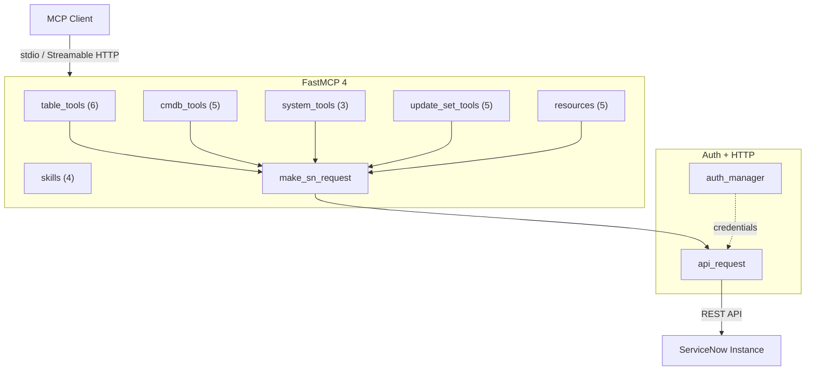

<!-- mcp-server: servicenow | tools: 19 | resources: 5 | skills: 4 | transport: stdio,streamable-http | auth: basic,oauth,api_key | framework: fastmcp-4.0 -->
<!-- mcp-name: io.github.jschuller/mcp-server-servicenow -->

<p align="center">
  
</p>

<h1 align="center">ServiceNow MCP Server</h1>

<p align="center">
  <a href="https://pypi.org/project/mcp-server-servicenow/"></a>
  <a href="https://www.python.org/"></a>
  <a href="https://gofastmcp.com"></a>
  <a href="#available-tools"></a>
  <a href="#resources"></a>
  <a href="#skills-served-over-mcp"></a>
  <a href="https://modelcontextprotocol.io"></a>
  <a href="LICENSE"></a>
  <a href="https://github.com/jschuller/mcp-server-servicenow/actions/workflows/ci.yml"></a>
  <a href="https://pypi.org/project/mcp-server-servicenow/"></a>
</p>

<p align="center">
  The developer data plane for ServiceNow in Claude Code — Table API, schema, aggregates and update sets,<br>
  on any release from Tokyo up, on PDIs, in GCC, for free. Runs alongside ServiceNow's native MCP Server.
</p>

---

`Table API` · `CMDB` · `Update Sets` · `Aggregation` · `Resources` · `Read-only mode` · `Audit log` · `OAuth 2.1+PKCE` · `Streamable HTTP` · `4 Skills over MCP` · `Claude Code Plugin`

## What This Does

This MCP server gives AI assistants the raw ServiceNow data plane: any table via the Table API, the data dictionary (with inherited fields), Stats API aggregates, CMDB classes and relationships, and update sets. 19 tools, 5 resources and 4 Agent Skills served over MCP, with tool annotations, an optional read-only mode, table allow/deny lists, hardened encoded queries, and a JSON audit line per call.

Built with [FastMCP 4.0](https://gofastmcp.com) — speaks both the stateless MCP 2026-07-28 protocol and the legacy handshake, negotiated per connection.

## Alongside ServiceNow's native MCP Server

ServiceNow's **MCP Server Console** (Action Fabric) exposes Now Assist skills, Knowledge Graph, flows, scripted REST and playbooks as governed tools — and **excludes the Table API by design** ("cannot be converted to MCP tools regardless of configuration"). This project is the other half: the developer loop that native does not serve. ServiceNow's own CEG AI CoE guide lists `uvx mcp-server-servicenow` as its community "Path C".

| | Native MCP Server Console | This project |
|---|---|---|
| **Tool sources** | Now Assist skills, Knowledge Graph, subflows/actions, scripted REST (GET/POST/PUT), playbooks, MCP Apps | Table API CRUD, Stats API aggregates, `sys_dictionary` schema, update sets, CMDB via Table API |
| **Table API** | Excluded by design | Any table, any field |
| **Minimum release** | Zurich P9 / Australia P2 for custom tools | Tokyo+ |
| **Entitlement** | Now Assist / AI-Native SKU (docs: Prime for inbound); metered in assists | MIT, $0, your own compute |
| **PDIs / GCC** | Not available | Works |
| **Auth** | OAuth 2.0 auth-code via Machine Identity Console (JWT, no DCR) | OAuth 2.1 + PKCE proxy (DCR + CIMD), static tokens, or a service account |
| **Governance** | AI Control Tower / AI Gateway | Self-managed: `--read-only`, table allow/deny, opt-in write confirmation, audit log, tool annotations |
| **Transport** | Streamable HTTP only | stdio + Streamable HTTP |
| **Resources / skills / prompts** | Roadmap | 5 resources; 4 Agent Skills served as `skill://` resources (SEP-2640); prompts planned for 0.9 |

**Run both.** Native tells Claude what ServiceNow *means* (skills, summaries, semantic search); this server tells Claude what ServiceNow *contains* (rows, schema, aggregates, update sets). No tool-name collisions today.

## Getting Started

About ten minutes on a free developer instance. On a company instance, ask your ServiceNow admin for the user in step 2.

### 1. Get a ServiceNow instance

Sign up for a free [Personal Developer Instance (PDI)](https://developer.servicenow.com/) — it comes with demo incidents, changes and CIs. PDIs hibernate after a few hours idle: wake yours from the developer portal before you start.

### 2. Create an integration user

Don't connect as `admin`: new instances refuse REST basic auth for it ([why](TROUBLESHOOTING.md#401-unauthorized)), and the server needs far less.

1. Sign in as admin and go to **All › User Administration › Users › New**.
2. **User ID** `mcp.integration`, **Identity type** *Machine* (this ticks **Web service access only**), and tick **Internal Integration User**. If your form has no Identity type, tick Web service access only yourself. **Submit**, then open the user again.
3. **Set Password**, and keep the password for step 3.
4. **Roles › Edit**: add `itil` and `snc_read_only`, save.

That user can read incidents, changes, problems, CMDB and aggregates, and can't change anything. Schema, update sets and writes need more: see [what each tool needs](#what-each-tool-needs).

### 3. Add the server to your client

You need [uv](https://docs.astral.sh/uv/getting-started/installation/) (`uvx` runs the server without installing it). In Claude Code:

```bash
read -rs SERVICENOW_PASSWORD     # paste the password; it is not shown or kept in your history
claude mcp add servicenow \
  -e SERVICENOW_INSTANCE_URL=https://devNNNNNN.service-now.com \
  -e SERVICENOW_USERNAME=mcp.integration \
  -e SERVICENOW_PASSWORD="$SERVICENOW_PASSWORD" \
  -- uvx mcp-server-servicenow --read-only
```

On Windows (PowerShell 7) read the password with `$p = Read-Host -MaskInput 'Password'` and pass `-e SERVICENOW_PASSWORD=$p`. Claude Code keeps the value in its own config; for a company instance, use one of the patterns in [keeping secrets out of config files](docs/configuration.md#keeping-secrets-out-of-config-files). Codex, pi, Claude Desktop, VS Code and Cursor: see [Configuration](#configuration).

### 4. Check it works

Ask: *"List the 5 most recent incidents."* An error about HTML instead of JSON means the PDI is asleep ([wake it](TROUBLESHOOTING.md#instance-is-hibernating)); a 401 means the password is wrong or the user isn't *Web service access only* ([401](TROUBLESHOOTING.md#401-unauthorized)). `--read-only` hides the write tools; drop it once the user has write roles.

### From source

```bash
git clone https://github.com/jschuller/mcp-server-servicenow.git
cd mcp-server-servicenow
uv sync

export SERVICENOW_INSTANCE_URL=https://devNNNNNN.service-now.com
export SERVICENOW_USERNAME=mcp.integration
read -rs SERVICENOW_PASSWORD && export SERVICENOW_PASSWORD

uv run mcp-server-servicenow --read-only          # stdio, for local clients

# Streamable HTTP (remote access / Cloud Run) fails closed: it needs MCP
# endpoint auth on top of the ServiceNow credentials. Static bearer tokens
# here; docs/deployment.md covers OAuth 2.1 + PKCE.
uv run mcp-server-servicenow --transport streamable-http --port 8080 \
  --mcp-static-tokens "$(openssl rand -hex 32)"
```

## Available Tools

### Table API (6 tools)
| Tool | Description |
|------|-------------|
| `list_records` | List records from any table with filtering, field selection, and pagination |
| `get_record` | Get a single record by sys_id |
| `create_record` | Create a new record in any table |
| `update_record` | Update an existing record (optional confirmation, see below) |
| `delete_record` | Delete a record by sys_id (optional confirmation, see below) |
| `aggregate_records` | COUNT, AVG, MIN, MAX, SUM with GROUP BY + HAVING via Stats API |

### CMDB (5 tools)
| Tool | Description |
|------|-------------|
| `list_ci` | List configuration items with class and query filtering |
| `get_ci` | Get a single CI by sys_id |
| `create_ci` | Create a new configuration item |
| `update_ci` | Update a configuration item (optional confirmation, see below) |
| `get_ci_relationships` | Get parent/child relationships for a CI (paged: `limit`, `offset`) |

### System (3 tools)
| Tool | Description |
|------|-------------|
| `get_system_properties` | Query system properties |
| `get_current_user` | Get authenticated user info |
| `get_table_schema` | Table data dictionary incl. inherited fields (`hierarchy`, per-field `defined_in`) |

### Update Sets (5 tools)
| Tool | Description |
|------|-------------|
| `list_update_sets` | List update sets with state filtering |
| `get_update_set` | Get update set details |
| `create_update_set` | Create a new update set |
| `set_current_update_set` | Set the active update set |
| `list_update_set_changes` | List changes within an update set |

### What each tool needs

ServiceNow's ACLs decide what the user can do; the server adds nothing on top. Base-system roles, from least to most:

| You want | Roles | Run with |
|---|---|---|
| Read ITSM and CMDB data (the [start-here](#2-create-an-integration-user) user) | `itil` + `snc_read_only` | `--read-only` |
| …and create or update incidents and CIs | `itil` (no `snc_read_only`) | `--write-confirm` if you want a prompt |
| …and delete incidents, problems, changes | add `itil_admin` | |
| Table schemas (`get_table_schema`, `servicenow://schema/*`) | add `personalize_dictionary` | |
| Update sets, system properties | `admin` — on a PDI only | |

| Tool or resource | Needs | Without it |
|---|---|---|
| `list_records`, `get_record`, `aggregate_records` | read access to that table (`itil` for task tables) | 403, or rows filtered out |
| `create_record`, `update_record` | write access to that table (`itil` for incidents) | 403 |
| `delete_record` | delete access (`itil_admin` for incidents) | 403 |
| `list_ci`, `get_ci`, `get_ci_relationships`, `servicenow://cmdb/classes` | `itil` or `cmdb_read` | 403, or rows filtered out |
| `create_ci`, `update_ci` | write access to the CI class | 403 |
| `get_table_schema`, `servicenow://schema/{table}` | `personalize_dictionary` | 403 naming the role |
| `get_system_properties` | `admin` | **an empty list, no error** |
| `get_current_user`, `servicenow://instance`, `servicenow://update-set/current` | any user | `instance` omits the platform version without `admin` |
| update-set tools | `admin` | 403 |

The reads, the empty `get_system_properties` and the 403s were checked live on a Brazil PDI on 2026-10-11 as `itil` + `snc_read_only`, and the record writes, schema and update-set tools as `admin`; the `itil` write, `itil_admin` delete and CI write rows follow ServiceNow's base-system role documentation. An instance with custom ACLs can differ — the error text names the API and method. API-key users also need a REST API access policy for each API they call (Table, Aggregate): see [TROUBLESHOOTING](TROUBLESHOOTING.md#401-unauthorized).

## Resources

MCP Resources provide read-only context that LLM clients can fetch without tool calls — reducing latency and token overhead.

| Resource URI | Description |
|-------------|-------------|
| `servicenow://schema/{table_name}` | Field definitions (name, type, label, mandatory, reference, defined_in) for any table, parents included |
| `servicenow://instance` | Instance URL, platform version, logged-in user, timezone |
| `servicenow://update-set/current` | Currently active update set name, sys_id, state |
| `servicenow://cmdb/classes` | CMDB CI class hierarchy (names, labels, parent classes) |
| `servicenow://help/query-syntax` | Encoded query operators reference (prevents hallucinated syntax) |

## Skills (served over MCP)

Four [Agent Skills](https://agentskills.io) — guided, multi-step workflows that chain the tools above — ship inside the package and are served over MCP as resources, following the convention the MCP Skills Over MCP working group standardised in [SEP-2640](https://github.com/modelcontextprotocol/modelcontextprotocol/pull/2640). Every install gets them, on every client, with no plugin.

| Skill | URI | What it guides |
|-------|-----|----------------|
| **triaging-incidents** | `skill://triaging-incidents/SKILL.md` | List, triage, investigate and create incidents; 30-day trend reports; SLA breaches |
| **servicenow-cmdb** | `skill://servicenow-cmdb/SKILL.md` | CI class hierarchy, dependency maps, CMDB health and full audits, data quality, CSDM taxonomy |
| **reviewing-update-sets** | `skill://reviewing-update-sets/SKILL.md` | Deep review, batch review, comparison and pre-promotion checks for update sets |
| **exploring-tables** | `skill://exploring-tables/SKILL.md` | Schema discovery, field types, data profiling, table search and comparison |

Each skill also exposes `skill://<name>/_manifest` (a JSON file list with SHA-256 digests, so a host can verify what it loaded) and its reference material as sibling resources, e.g. `skill://triaging-incidents/references/incident-fields.md`. Every read is an audit line.

How clients pick them up:

- **Claude Code** reads them on its own: the server's `instructions` tell the model which skill matches which request, and the model fetches the resource before calling tools. The Claude Code plugin additionally installs the same four files as filesystem skills.
- **Codex CLI and pi** expose MCP resources to the model (`list_mcp_resources` / `read_mcp_resource`). Codex follows the instructions and reads the matching skill unprompted; pi passes only their first line, so its model reads a skill when asked. Both also load the same `SKILL.md` folders from disk (`~/.agents/skills/`, or pi's `--skill <dir>`).
- **Hosts implementing SEP-2640** list them next to local skills and load them on activation. The server will declare the extension (`skills/list`) once FastMCP ships it.
- **Claude Desktop** lists them under the server's connector entry in the `+` menu; attaching one reads it over MCP and lands an audit line (verified on Desktop 1.46388.4).
- **Any other client that surfaces MCP resources** — VS Code's *Add Context → MCP Resources*, Gemini CLI's `@skill://…` — can attach them like any resource.

The **update set reviewer** remains a differentiator: no other open-source ServiceNow MCP server provides guided update set review with risk categorization and pre-promotion checklists — and none serves skills over MCP.

## Safety & governance

Every tool carries MCP annotations (`readOnlyHint`, `destructiveHint`, `idempotentHint`, `openWorldHint`) so clients such as Claude Code can apply their own permission policy. On top of that, the server ships its own guardrails — all off by default except the audit log:

| Flag | Env var | Effect |
|------|---------|--------|
| `--read-only` | `SERVICENOW_READ_ONLY=true` | Hides the 7 write tools from `tools/list` **and** refuses any non-GET request at the HTTP layer |
| `--table-allowlist a,b*` | `SERVICENOW_TABLE_ALLOWLIST` | Only these tables (exact or glob) may be accessed — applies to `table_name`, `class_name`, fixed-table tools and the schema resource |
| `--table-denylist sys_user*` | `SERVICENOW_TABLE_DENYLIST` | These tables may never be accessed; wins over the allowlist |
| *(always on)* | — | Table names, sys_ids, field lists and `order_by` are validated; `javascript:` in caller queries is limited to `gs.*` date helpers (`gs.daysAgo(7)`, `gs.beginningOfToday()` …) |
| `--allow-js-queries` | `SERVICENOW_ALLOW_JS_QUERIES=true` | Re-enable arbitrary `javascript:` in queries |
| `--write-confirm` | `SERVICENOW_WRITE_CONFIRM=true` | Ask the user before `update_record`, `update_ci`, `delete_record` (see below) |
| `--audit-log stderr\|off\|PATH` | `SERVICENOW_AUDIT_LOG` | One JSON line per tool call / resource read (default: stderr) |

An audit line (keys only — never values):

```json
{"ts":"2026-08-22T19:04:11.512+00:00","run_id":"…","event":"tool_call","name":"update_record","user":"admin","auth_mode":"service-account","transport":"stdio","table":"incident","sys_id":"9d385017c611228701d22104cc95c371","data_keys":["state"],"tags":["table","write"],"outcome":"ok","duration_ms":212.4}
```

### Write confirmation (opt-in)

With `--write-confirm`, the three destructive tools fetch the record's current values and ask the user before writing:

- **Claude Code** (2.1.292+ speaks the 2026-07-28 protocol on stdio) and **Cursor** render the prompt as a dialog. *Decline* stops the write; the assistant is told not to retry.
- **Older handshake-era clients** get the same prompt through `elicitation/create` — **Codex CLI** (2025-06-18) shows it as a form after its own tool approval. The server never asks a client that has not declared elicitation.
- **pi, Claude Desktop / Cowork, claude.ai connectors and headless runs** cannot show the prompt (Desktop answers with a synthetic *cancel*). They receive a `confirmation_required` error carrying the preview; the assistant shows it and re-runs with `confirm=true`.

It is off by default because the MCP client's own permission prompt is the primary human-in-the-loop, and because automation cannot answer a dialog. Enable it where an AI Steward wants a second gate.

## Architecture



The server is also a building block: mount it into your own FastMCP server and it keeps its read-only mode, allow/deny lists and audit log. FastMCP does not forward a mounted server's instructions and prefixes its URIs, so pass the rendered ones on:

```python
from fastmcp import FastMCP
from servicenow_mcp.server import mcp as servicenow, render_instructions

app = FastMCP("orchestrator", instructions=render_instructions("snow"))
app.mount(servicenow, namespace="snow")  # tools snow_*, resources skill://snow/…
```

## Verified clients

Checked on 2026-10-10/11 against a ServiceNow Brazil instance (stdio, read-only API-key identity, this release):

| | Claude Code 2.1.296 | Codex CLI 0.162.1 | pi 1.1.0 |
|---|---|---|---|
| Protocol negotiated | 2026-07-28 | 2025-06-18 | 2025-11-25 |
| Tools + annotations | ✓ (12 in `--read-only`) | ✓ read-only tools run without approval; `codex exec` refuses the rest | ✓ (`--exposure direct`) |
| Skills as MCP resources | ✓ read before querying, unprompted | ✓ read before querying, unprompted | ✓ when asked (pi passes only the first line of `instructions`) |
| Skills from disk | ✓ plugin: `/servicenow:<skill>` | not tested | listed with `--skill <dir>` |
| `--write-confirm` | ✓ dialog; Decline stops the write | ✓ form after Codex's own approval; *False* stops the write | ✓ `confirmation_required` → `confirm=true` |

The clients ran with a read-only identity. The write paths (create/update/delete, write confirmation in both protocol eras, update sets, schema) were checked separately over Streamable HTTP with an admin's own ServiceNow OAuth token forwarded per user: `scripts/stdio_smoke.py --profile write`, 41/41, audit lines carry the caller (`"user":"admin","auth_mode":"oauth"`).

## Configuration

Add to your MCP client config — copy the snippet for your tool:

<details>
<summary><strong>Claude Code</strong></summary>

```bash
claude mcp add servicenow -- uvx mcp-server-servicenow \
  --instance-url https://your-instance.service-now.com \
  --auth-type basic --username mcp.integration --password your-password
```
</details>

<details>
<summary><strong>Claude Desktop</strong></summary>

Add to `~/Library/Application Support/Claude/claude_desktop_config.json`:
```json
{
  "mcpServers": {
    "servicenow": {
      "command": "uvx",
      "args": ["mcp-server-servicenow"],
      "env": {
        "SERVICENOW_INSTANCE_URL": "https://your-instance.service-now.com",
        "SERVICENOW_AUTH_TYPE": "basic",
        "SERVICENOW_USERNAME": "mcp.integration",
        "SERVICENOW_PASSWORD": "your-password"
      }
    }
  }
}
```
</details>

<details>
<summary><strong>Codex CLI</strong></summary>

```bash
codex mcp add servicenow \
  --env SERVICENOW_INSTANCE_URL=https://your-instance.service-now.com \
  --env SERVICENOW_AUTH_TYPE=basic --env SERVICENOW_USERNAME=svc.mcp \
  -- uvx mcp-server-servicenow --read-only
```
Codex auto-approves tools annotated `readOnlyHint` and asks before the rest. Keep the password out of `config.toml`: forward it from your shell with `env_vars = ["SERVICENOW_PASSWORD"]`, or wrap the command in a secret-store launcher.
</details>

<details>
<summary><strong>pi</strong> (1.0+, built-in MCP)</summary>

```bash
pi mcp add servicenow --exposure direct \
  --env SERVICENOW_INSTANCE_URL=https://your-instance.service-now.com \
  --env SERVICENOW_AUTH_TYPE=basic --env SERVICENOW_USERNAME=svc.mcp \
  --env 'SERVICENOW_PASSWORD=${SERVICENOW_PASSWORD}' \
  -- uvx mcp-server-servicenow --read-only
pi mcp list   # connects and lists 12 tools, 15 resources
```
`--exposure direct` lets the model call the tools by name (pi's default, `codemode`, wraps them in scripts). pi has no permission prompts or elicitation: use `--read-only`, or `--write-confirm` for the `confirmation_required` → `confirm=true` round trip.
</details>

<details>
<summary><strong>VS Code</strong></summary>

Add to `.vscode/mcp.json`:
```json
{
  "servers": {
    "servicenow": {
      "type": "stdio",
      "command": "uvx",
      "args": ["mcp-server-servicenow"],
      "env": {
        "SERVICENOW_INSTANCE_URL": "https://your-instance.service-now.com",
        "SERVICENOW_AUTH_TYPE": "basic",
        "SERVICENOW_USERNAME": "mcp.integration",
        "SERVICENOW_PASSWORD": "your-password"
      }
    }
  }
}
```
</details>

<details>
<summary><strong>Cursor</strong></summary>

Add to `.cursor/mcp.json`:
```json
{
  "mcpServers": {
    "servicenow": {
      "command": "uvx",
      "args": ["mcp-server-servicenow"],
      "env": {
        "SERVICENOW_INSTANCE_URL": "https://your-instance.service-now.com",
        "SERVICENOW_AUTH_TYPE": "basic",
        "SERVICENOW_USERNAME": "mcp.integration",
        "SERVICENOW_PASSWORD": "your-password"
      }
    }
  }
}
```
</details>

See [Configuration Guide](docs/configuration.md) for OAuth, multi-instance, and the full environment variable reference.

## Deployment

See [Deployment Guide](docs/deployment.md) — Docker, Cloud Run, HTTP transport verification, and the security model.

## Troubleshooting

See [TROUBLESHOOTING.md](TROUBLESHOOTING.md) for common issues (hibernating instances, 401 errors, OAuth).

## Development

```bash
# Install with dev dependencies
pip install -e ".[dev]"

# Run unit tests
python -m pytest tests/ -v --ignore=tests/integration

# Live tests read credentials from the environment only (use a secret-store
# launcher rather than a file). Refused tools are skipped with the missing grant.
SERVICENOW_INSTANCE_URL=https://your-pdi.service-now.com \
SERVICENOW_USERNAME=svc.mcp SERVICENOW_PASSWORD=... \
python -m pytest tests/integration/ -v

# End-to-end over stdio, both protocol eras (readonly profile changes nothing)
python scripts/stdio_smoke.py --profile readonly

# Lint
ruff check src/ tests/
```

## Claude Code Plugin

Install as a Claude Code plugin for zero-config setup: the plugin wires up the MCP server and installs the same four skills as filesystem skills, so they auto-trigger from conversation even before Claude Code consumes skills over MCP natively.

### Prerequisites

Set these environment variables (or add them to your shell profile):

```bash
export SERVICENOW_INSTANCE_URL="https://your-instance.service-now.com"
export SERVICENOW_AUTH_TYPE="basic"  # or "oauth"
export SERVICENOW_USERNAME="mcp.integration"
export SERVICENOW_PASSWORD="your-password"
# For OAuth only:
export SERVICENOW_CLIENT_ID="your-client-id"
export SERVICENOW_CLIENT_SECRET="your-client-secret"
```

### Install from Git

```bash
claude plugin marketplace add jschuller/mcp-server-servicenow
claude plugin install servicenow@mcp-server-servicenow
```

### Install Locally (development)

```bash
claude --plugin-dir /path/to/mcp-server-servicenow
```

The skills appear as `/servicenow:triaging-incidents`, `/servicenow:servicenow-cmdb`, `/servicenow:reviewing-update-sets` and `/servicenow:exploring-tables` (Claude Code skills double as slash commands). In 0.8.0 these replaced the 0.7.x commands (`/servicenow:triage`, `/servicenow:cmdb`, `/servicenow:explore-table`, `/servicenow:review-update-set`) and the `servicenow-admin` subagent.

> **Note:** The plugin auto-configures the MCP server — no manual `.mcp.json` setup required.

## Roadmap

- **Phase 1** &#x2705; Foundation — 18 tools, OAuth retry, structured error handling
- **Phase 2** &#x2705; Remote access — FastMCP 3.0, Streamable HTTP, Cloud Run deployment
- **Phase 3** &#x2705; Security — OAuth 2.1 + PKCE proxy, per-user SN auth, matches native Zurich model
- **Phase 4** &#x2705; Skills & workflows — 4 skills (CMDB, table explorer, update set reviewer, incident triage)
- **Phase 4.5** &#x2705; Plugin packaging — Claude Code plugin, zero-config install
- **Phase 5** &#x2705; Distribution — PyPI package, [MCP Registry](https://registry.modelcontextprotocol.io), automated publish workflows
- **Sprint 2** &#x2705; FastMCP 3.1.1 — MultiAuth, token caching, connection pooling, response limiting, tool tags
- **Sprint 3** &#x2705; Resources + Aggregation — 5 MCP resources, `aggregate_records` Stats API tool
- **v0.6.0** &#x2705; FastMCP 4.0 — MCP 2026-07-28 stateless protocol support, fail-closed HTTP hardening, community fixes
- **v0.6.1** &#x2705; OAuth ROPC timeout + refresh-token grant, mypy in CI, dependency refresh
- **v0.7.0** &#x2705; Safety & governance — tool annotations, read-only mode, table allow/deny lists, opt-in destructive-call confirmation, JSON audit log, schema inheritance
- **v0.8.0** Skills over MCP — the four skills ship in the wheel as `skill://` resources (SEP-2640 shape), server instructions, `render_instructions` for composition, update-set preference and auth fixes; verified with Claude Code, Codex and pi
- **Next** — declare the SEP-2640 skills extension when FastMCP ships it, a read-only `check_connection` diagnostic, MCP prompts (v0.9), "Run alongside native" guide, per-token scopes over HTTP

## Related Projects

- **[sn-app-template](https://github.com/jschuller/sn-app-template)** — ServiceNow scoped app template for Claude Code + now-sdk. Pairs with this MCP server for AI-assisted development.

## License

[MIT](LICENSE)
