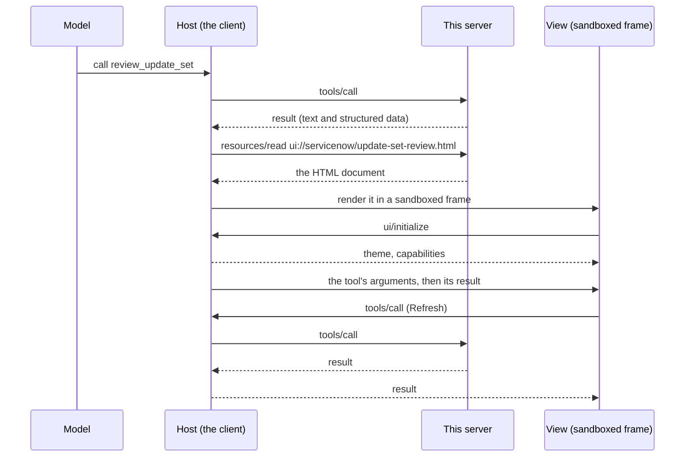

# MCP Apps views

Experimental, off by default. With `--apps on` the server adds views: small HTML screens that a client shows inside the conversation, next to the tool result they draw. The first one is a filterable table of an update set's changes.

Views use [MCP Apps](https://modelcontextprotocol.io/extensions/apps/overview), the official MCP extension `io.modelcontextprotocol/ui`. Nothing here is specific to one client.

- [Turn it on](#turn-it-on)
- [How it works](#how-it-works)
- [What it changes in the server](#what-it-changes-in-the-server)
- [The parts you can reuse](#the-parts-you-can-reuse)
- [Build your own view](#build-your-own-view)
- [Under a mount namespace](#under-a-mount-namespace)
- [Security](#security)
- [Limits](#limits)

## Turn it on

Add `--apps on` to the server's arguments:

```json
{
  "mcpServers": {
    "servicenow": {
      "command": "uvx",
      "args": ["mcp-server-servicenow", "--apps", "on"],
      "env": { "SERVICENOW_INSTANCE_URL": "https://<instance>.service-now.com" }
    }
  }
}
```

Or set `SERVICENOW_APPS=on` in the server's environment; the argument wins when both are given. Any value other than `on` or `off` stops the server at startup.

Then ask for a review of an update set, for example "list the update sets, then review the one named REL-12". The model calls `review_update_set`, and the client shows the table.

| You get | What it is |
|---|---|
| Tool `review_update_set` | Reads one update set: name, state, scope, and its changes (type, target, action, author), newest first. At most 200 changes. Read-only |
| Resource `ui://servicenow/update-set-review.html` | The view: type filters, a search box and a Refresh button |

**Which clients show the view.** Clients that support MCP Apps: Claude (web, desktop, mobile), ChatGPT, VS Code with GitHub Copilot, Cursor, Goose and others in the [client matrix](https://modelcontextprotocol.io/extensions/client-matrix). Verified with Claude Desktop from a config-file entry. A client without MCP Apps, such as Claude Code in a terminal, gets the same result as text: there is no second tool to call.

**Which identity can use it.** Update sets need an identity that can read `sys_update_set` and `sys_update_xml`, which means `admin` on a default instance. Other identities get ServiceNow's 403 as the tool's error.

## How it works

An MCP App is two ordinary MCP objects that point at each other:

1. **A tool.** Its `_meta.ui.resourceUri` names a resource.
2. **A resource under `ui://`.** One HTML document, served with the MIME type `text/html;profile=mcp-app`.



Three things follow from that shape:

- **The model and the view read the same result.** The view draws the tool's structured data; it has no data of its own.
- **The view never talks to ServiceNow or to this server.** It talks to the host with JSON-RPC over `postMessage`. A tool call from the view (Refresh) goes through the host, so the server sees an ordinary `tools/call`.
- **The host owns the frame.** It decides the size, the theme, what the view may load, and when the view is torn down.

## What it changes in the server

With `--apps off` (the default): nothing. The tool list, the resource list and [`contract.json`](contract.json) are the same as before.

With `--apps on`:

| Where | Change |
|---|---|
| `tools/list` | One more read tool, `review_update_set`, with `_meta.ui.resourceUri` |
| `resources/list` | One more resource, `ui://servicenow/update-set-review.html` |
| Audit log | Calls to the tool are logged like any other, with table `sys_update_set`. A view's read of the `ui://` resource is logged as a resource read |
| Policy checks | `update_set_sys_id` is checked as an identifier, as for the other update set tools |
| `--read-only`, read-only identities | Unchanged: the tool only issues GET requests and stays listed |
| Server instructions | Unchanged |

In the source:

| File | Role |
|---|---|
| `src/servicenow_mcp/apps/__init__.py` | The Python side: `table_view`, `compose_view`, `add_app`, `view_problems`, the `review_update_set` tool, `register_apps` |
| `src/servicenow_mcp/apps/bridge.js` | `McpApp`: the view side of the protocol |
| `src/servicenow_mcp/apps/base.css` | Theme tokens and shared styles |
| `src/servicenow_mcp/apps/table_view.html` | The table view: markup and its script. The update set view is this with settings |
| `src/servicenow_mcp/cli.py`, `utils/config.py` | The `--apps` switch, `SERVICENOW_APPS` and `ServerConfig.apps` |
| `src/servicenow_mcp/skill_lint.py` | A skills plugin may pass `--apps on\|off` or set `SERVICENOW_APPS`, with a pin of 0.9.4 or later |
| `src/servicenow_mcp/middleware/policy.py` | The audit table for the new tool |
| `tests/test_apps.py` | Tests of all of the above |

## The parts you can reuse

The package ships the pieces a view is made of. A view of a list is a function and a few settings; anything else is a function, some markup and a short script.

**Python** (`from servicenow_mcp import apps`):

| Name | What it does |
|---|---|
| `apps.table_view(title=..., rows=..., columns=[...])` | A complete view that draws a result's rows as a table, with a search box and a Refresh button. Optional: `facet=` (filter chips), `header=` (one record above the table), `search=`, `noun=`, `limit=`, `empty=`. See [the settings](#table-view-settings) |
| `apps.compose_view(fragment, title=...)` | Wraps your fragment (markup, optional `<style>`, a `<script>`) into one self-contained document with `base.css` and `bridge.js` inlined |
| `apps.add_app(server, fn, uri=..., view=...)` | Registers `fn` as a tool and `view` as the `ui://` resource the tool names, and writes the tool's name into the view. It refuses a `uri` outside `ui://` and a view that fails `view_problems`. `tags=` and `annotations=` as for any tool; annotations default to the read-only set. `namespace=` only for a server you mount under one: see [Under a mount namespace](#under-a-mount-namespace) |
| `apps.view_problems(document)` | Lists what stops a document from being self-contained and text-safe (a URL, a loaded file, a network call, text written as markup). Empty when it is fine |
| `apps.asset(name)` | The text of `bridge.js`, `base.css` or a shipped view fragment, if you compose a document yourself |
| `apps.register_apps(server)` | Registers the built-in views; what `--apps on` calls. `namespace=` as for `add_app` |

**JavaScript** (`McpApp`, available to your fragment's script):

| Name | What it does |
|---|---|
| `McpApp.connect({name, version, onInput, onResult, onCancelled, onContext})` | Connects to the host and resolves to `app`. It applies the host's theme and reports the content height for you |
| `app.callTool()` | Calls the tool that opened the view again, with the same arguments. `app.callTool(name, args)` calls another tool of the same server |
| `app.canCallTools`, `app.toolName`, `app.args` | Whether the host lets the view call tools; the opening tool's name (the one the host gives, else the one `add_app` wrote into the view); its last arguments |
| `McpApp.data(result)` | The result's structured data, or its first text block parsed as JSON |
| `McpApp.errorText(result)` | The message of an error result, or `null` |
| `McpApp.el(tag, className, text)` | A new element. Text goes in through `textContent` |
| `McpApp.text(value)` | A field as plain text, also for `{display_value, value}` pairs |

**CSS** (`base.css`): colours and fonts follow the host's style variables, with light and dark fallbacks. Classes: `.badge` (`.danger`), `.chips` and `.chip`, `.scroll`, `.sub`, `.note`, `.error`, `.foot`, `.sr-only`; plain `table`, `button` and `input` are styled.

## Build your own view

This adds a second view, a table of open incidents, to the server. It follows [mounting it in your own server](architecture.md#mounting-it-in-your-own-server): your file imports the package, registers what it wants, and runs.

```python
"""my_server.py: the ServiceNow server plus one view of my own."""
from servicenow_mcp import apps
from servicenow_mcp.server import init_services, mcp
from servicenow_mcp.utils.config import ServerConfig

init_services(ServerConfig(..., apps=True))  # your instance and auth

# Tools register when their modules are imported, after init_services().
import servicenow_mcp.resources  # noqa: E402,F401
import servicenow_mcp.tools.cmdb_tools  # noqa: E402,F401
import servicenow_mcp.tools.system_tools  # noqa: E402,F401
import servicenow_mcp.tools.update_set_tools  # noqa: E402,F401
from servicenow_mcp.tools import table_tools  # noqa: E402


def open_incidents(limit: int = 25) -> dict:
    """List open incidents, highest priority first. Clients that support MCP Apps show a table."""
    return table_tools.list_records(
        table_name="incident",
        query="active=true",
        fields="number,priority,short_description,assigned_to.name",
        order_by="priority",
        limit=limit,
    )


VIEW = apps.table_view(
    title="Open incidents",
    rows="records",  # where the rows are in the tool's result
    columns=[
        {"key": "number", "label": "Number", "nowrap": True},
        {"key": "priority", "label": "Priority", "badge": True, "danger": ["1"]},
        {"key": "short_description", "label": "Short description", "sub": "assigned_to.name", "wide": True},
    ],
    facet="priority",  # one filter chip per priority
    noun=("incident", "incidents"),
)

apps.register_apps(mcp)  # the built-in update set view
apps.add_app(
    mcp,
    open_incidents,
    uri="ui://servicenow/open-incidents.html",
    view=VIEW,
    tags={"read"},
)

if __name__ == "__main__":
    mcp.run()
```

Because the tool is added to the package's own server object, the audit log and the policy checks apply to it.

To try a view without a chat client, FastMCP has a local host: `fastmcp dev apps my_server.py` (it needs the `fastmcp[apps]` extra) opens a page that lists the server's app tools and renders the one you launch. From a checkout of this repository, `scripts/apps_preview.py` does the same for the built-in view with made-up data and no instance.

### Table view settings

`table_view()` writes its settings into the document it returns, because a view is static text and cannot ask the server for them. A wrong setting (an unknown option, a column without a key) stops at once with a `ValueError`.

| Setting | What it does |
|---|---|
| `title` | The document's title, and the heading when `header` gives none |
| `rows` | The key of the row list in the tool's result: `"records"` for `list_records` and `list_ci` |
| `columns` | The columns, in order. Each is `{"key": ...}` plus options, below |
| `facet` | A field whose values become filter chips, most common first |
| `search` | The fields the search box looks in. Default: every column's `key` and `sub`. `[]` hides the box |
| `header` | One record of the result, shown above the table: `{"key": ..., "title": ..., "badge": ..., "details": [{"key": ..., "label": ...}], "text": ...}`. `key` says where the record is in the result; the others name its fields |
| `noun` | What a row is called, singular and plural: `("incident", "incidents")` |
| `limit` | The key of the limit the call used, if the result carries it. The footer then says when the limit cut the list |
| `empty` | The text for a result without rows |

| Column option | What it does |
|---|---|
| `key` | The row's field, as the tool returns it. A dot-walked field is one key: `"assigned_to.name"` |
| `label` | The heading. Default: the key |
| `sub` | A second field, shown small under the first |
| `badge` | Draws the value as a badge |
| `danger` | Values drawn in the danger colour and counted in the footer: `["DELETE"]` |
| `wide`, `nowrap`, `muted` | The column that takes the spare room; keep the value on one line; secondary colour |

The built-in update set view is a `table_view()` and nothing else: see `update_set_review_view()` in `apps/__init__.py`.

### A view of your own design

When a table is not what you need, write the fragment yourself and wrap it with `compose_view()`. The script gets `McpApp`:

```python
VIEW = apps.compose_view(
    """
<h1>Open incidents by priority</h1>
<div id="rows"></div>
<script>
McpApp.connect({
  name: "by-priority",
  onResult(result) {
    const rows = document.getElementById("rows");
    rows.replaceChildren();
    for (const group of McpApp.data(result).groups) {
      rows.append(McpApp.el("p", null, McpApp.text(group.priority) + ": " + McpApp.text(group.count)));
    }
  },
});
</script>
""",
    title="Open incidents by priority",
)
```

`add_app()` takes it like a table view. Before you register it, `apps.view_problems(VIEW)` lists what `add_app()` would refuse.

**Rules of thumb**

- **Give a view its own tool, one whose result is the answer.** A host draws the view on every call of a tool that names one, and the protocol has no way to skip it for one call. So do not attach a view to a tool the model calls many times on the way to an answer, such as `list_records` or `get_record`: write a small tool for the view, as `review_update_set` and `open_incidents` are.
- **Return structured data from the tool**, and make it useful as text: a client without MCP Apps shows only that.
- **Keep the view self-contained.** No CDN, no fonts, no images by URL. If a view must load something, declare the origins in an `AppConfig(csp=...)` and register it with FastMCP directly; `view_problems` is for views that load nothing.
- **Poll, do not wait.** A view gets no push updates. For fresh data, call the tool again.
- **A new URI for a view that no longer fits its old results.** A host may keep a view it has fetched. When you change what a view expects of the tool's result, serve it at a new URI (`…/open-incidents-2.html`) instead of changing the old one in place.
- **The same for every client.** Do not register a view, or change a result, by what a client says it supports: since MCP 2026-07-28 the tool list is the same for every connection. A host that draws no views ignores the link.
- **A view that writes** carries `tags={"write"}` and the matching annotations, so `--read-only` hides it. Let the person press the button: the model fills the form in, the view submits it.

## Under a mount namespace

A server mounted with a namespace gets new names: `parent.mount(servicenow, namespace="snow")` serves the tool as `snow_review_update_set` and the view at `ui://snow/servicenow/update-set-review.html`. FastMCP does not rewrite the URI in the tool's `_meta.ui.resourceUri`, and it never sees the tool name inside the view. So say the namespace once more, where the views are registered:

```python
apps.register_apps(servicenow, namespace="snow")  # and add_app(..., namespace="snow") for your own
parent.mount(servicenow, namespace="snow")
```

The tool then names the URI the parent serves, and the view calls the tool by the name the parent gives it. Use the same string in both lines, as for [`render_instructions("snow")`](architecture.md#mounting-it-in-your-own-server).

- **Only for a server you mount.** Registered with a namespace and served on its own, the tool names a view that is not there.
- **Mounting without a namespace needs nothing.**
- **Other tools a view calls** (`app.callTool(name, args)`) also carry the prefix under a mount: `snow_list_records`.

## Security

- **Record text is untrusted.** It comes from end users and other systems. The built-in view writes it with `textContent` only, and `view_problems` rejects `innerHTML` and its relatives.
- **The view loads and contacts nothing.** The host's default content security policy for a view (inline script and style, no network) is enough, and the built-in view asks for no more.
- **A view's tool calls are ordinary tool calls.** The host forwards them, and the server applies the same authentication, policy checks, read-only mode and audit log as for the model's calls.
- **Tool visibility is not a security boundary.** MCP Apps lets a tool be marked for the view only (`visibility: ["app"]`). That asks the host to hide it from the model; any client that knows the name can still call it. Do not rely on it to keep a write away from the model.
- **The view cannot reach the conversation or the client.** The host renders it in a sandboxed frame on a separate origin.

## Limits

- **Experimental.** The names of the parts and the settings of `table_view()` may change before a stable release.
- **One built-in view**, read-only. `table_view()` draws tables; there is no form or chart view yet.
- **The extension is advertised with `--apps off` too.** FastMCP before 4.2.0 lists `io.modelcontextprotocol/ui` in every server's capabilities, with or without a view ([FastMCP #4919](https://github.com/PrefectHQ/fastmcp/issues/4919)). No tool names a view then, so a host draws nothing.
- **At most 200 changes** per review. The view says when the limit cut the list.
- **Dates are UTC**, as stored, like the other update set tools.
- **The built-in view speaks protocol revision 2026-01-26**, the stable one.
