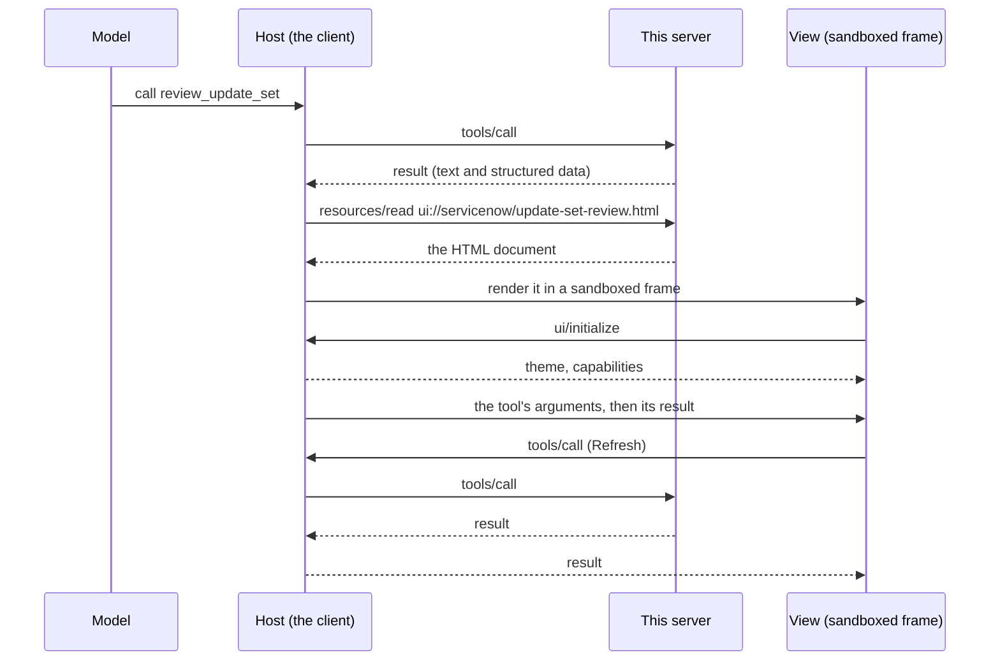

# MCP Apps views

Experimental, off by default. With `--apps on` the server adds views: small HTML screens that a client shows inside the conversation, next to the tool result they draw. The first one is a filterable table of an update set's changes.

Views use [MCP Apps](https://modelcontextprotocol.io/extensions/apps/overview), the official MCP extension `io.modelcontextprotocol/ui`. Nothing here is specific to one client.

- [Turn it on](#turn-it-on)
- [How it works](#how-it-works)
- [What it changes in the server](#what-it-changes-in-the-server)
- [The parts you can reuse](#the-parts-you-can-reuse)
- [Build your own view](#build-your-own-view)
- [Security](#security)
- [Limits](#limits)

## Turn it on

Add `--apps on` to the server's arguments:

```json
{
  "mcpServers": {
    "servicenow": {
      "command": "uvx",
      "args": ["mcp-server-servicenow", "--apps", "on"],
      "env": { "SERVICENOW_INSTANCE_URL": "https://<instance>.service-now.com" }
    }
  }
}
```

Then ask for a review of an update set, for example "list the update sets, then review the one named REL-12". The model calls `review_update_set`, and the client shows the table.

| You get | What it is |
|---|---|
| Tool `review_update_set` | Reads one update set: name, state, scope, and its changes (type, target, action, author), newest first. At most 200 changes. Read-only |
| Resource `ui://servicenow/update-set-review.html` | The view: type filters, a search box and a Refresh button |

**Which clients show the view.** Clients that support MCP Apps: Claude (web, desktop, mobile), ChatGPT, VS Code with GitHub Copilot, Cursor, Goose and others in the [client matrix](https://modelcontextprotocol.io/extensions/client-matrix). Verified with Claude Desktop from a config-file entry. A client without MCP Apps, such as Claude Code in a terminal, gets the same result as text: there is no second tool to call.

**Which identity can use it.** Update sets need an identity that can read `sys_update_set` and `sys_update_xml`, which means `admin` on a default instance. Other identities get ServiceNow's 403 as the tool's error.

## How it works

An MCP App is two ordinary MCP objects that point at each other:

1. **A tool.** Its `_meta.ui.resourceUri` names a resource.
2. **A resource under `ui://`.** One HTML document, served with the MIME type `text/html;profile=mcp-app`.



Three things follow from that shape:

- **The model and the view read the same result.** The view draws the tool's structured data; it has no data of its own.
- **The view never talks to ServiceNow or to this server.** It talks to the host with JSON-RPC over `postMessage`. A tool call from the view (Refresh) goes through the host, so the server sees an ordinary `tools/call`.
- **The host owns the frame.** It decides the size, the theme, what the view may load, and when the view is torn down.

## What it changes in the server

With `--apps off` (the default): nothing. The tool list, the resource list and [`contract.json`](contract.json) are the same as before.

With `--apps on`:

| Where | Change |
|---|---|
| `tools/list` | One more read tool, `review_update_set`, with `_meta.ui.resourceUri` |
| `resources/list` | One more resource, `ui://servicenow/update-set-review.html` |
| Audit log | Calls to the tool are logged like any other, with table `sys_update_set`. A view's read of the `ui://` resource is logged as a resource read |
| Policy checks | `update_set_sys_id` is checked as an identifier, as for the other update set tools |
| `--read-only`, read-only identities | Unchanged: the tool only issues GET requests and stays listed |
| Server instructions | Unchanged |

In the source:

| File | Role |
|---|---|
| `src/servicenow_mcp/apps/__init__.py` | The Python side: `compose_view`, `add_app`, `view_problems`, the `review_update_set` tool, `register_apps` |
| `src/servicenow_mcp/apps/bridge.js` | `McpApp`: the view side of the protocol |
| `src/servicenow_mcp/apps/base.css` | Theme tokens and shared styles |
| `src/servicenow_mcp/apps/update_set_review.html` | The update set view: markup and its script |
| `src/servicenow_mcp/cli.py`, `utils/config.py` | The `--apps` switch and `ServerConfig.apps` |
| `src/servicenow_mcp/middleware/policy.py` | The audit table for the new tool |
| `tests/test_apps.py` | Tests of all of the above |

## The parts you can reuse

The package ships the pieces a view is made of, so a view of your own is a function, some markup and a short script.

**Python** (`from servicenow_mcp import apps`):

| Name | What it does |
|---|---|
| `apps.compose_view(fragment, title=...)` | Wraps your fragment (markup, optional `<style>`, a `<script>`) into one self-contained document with `base.css` and `bridge.js` inlined |
| `apps.add_app(server, fn, uri=..., view=...)` | Registers `fn` as a tool and `view` as the `ui://` resource the tool names. `tags=` and `annotations=` as for any tool; annotations default to the read-only set |
| `apps.view_problems(document)` | Lists what stops a document from being self-contained and text-safe (a URL, a loaded file, a network call, text written as markup). Empty when it is fine |
| `apps.asset(name)` | The text of `bridge.js`, `base.css` or a shipped view fragment, if you compose a document yourself |
| `apps.register_apps(server)` | Registers the built-in views; what `--apps on` calls |

**JavaScript** (`McpApp`, available to your fragment's script):

| Name | What it does |
|---|---|
| `McpApp.connect({name, version, onInput, onResult, onCancelled, onContext})` | Connects to the host and resolves to `app`. It applies the host's theme and reports the content height for you |
| `app.callTool()` | Calls the tool that opened the view again, with the same arguments. `app.callTool(name, args)` calls another tool of the same server |
| `app.canCallTools`, `app.toolName`, `app.args` | Whether the host lets the view call tools; the opening tool's name (a mount may rename it); its last arguments |
| `McpApp.data(result)` | The result's structured data, or its first text block parsed as JSON |
| `McpApp.errorText(result)` | The message of an error result, or `null` |
| `McpApp.el(tag, className, text)` | A new element. Text goes in through `textContent` |
| `McpApp.text(value)` | A field as plain text, also for `{display_value, value}` pairs |

**CSS** (`base.css`): colours and fonts follow the host's style variables, with light and dark fallbacks. Classes: `.badge` (`.danger`), `.chips` and `.chip`, `.scroll`, `.sub`, `.note`, `.error`, `.foot`, `.sr-only`; plain `table`, `button` and `input` are styled.

## Build your own view

This adds a second view, a table of open incidents, to the server. It follows [mounting it in your own server](architecture.md#mounting-it-in-your-own-server): your file imports the package, registers what it wants, and runs.

```python
"""my_server.py: the ServiceNow server plus one view of my own."""
from servicenow_mcp import apps
from servicenow_mcp.server import init_services, mcp
from servicenow_mcp.utils.config import ServerConfig

init_services(ServerConfig(..., apps=True))  # your instance and auth

# Tools register when their modules are imported, after init_services().
import servicenow_mcp.resources  # noqa: E402,F401
import servicenow_mcp.tools.cmdb_tools  # noqa: E402,F401
import servicenow_mcp.tools.system_tools  # noqa: E402,F401
import servicenow_mcp.tools.update_set_tools  # noqa: E402,F401
from servicenow_mcp.tools import table_tools  # noqa: E402


def open_incidents(limit: int = 25) -> dict:
    """List open incidents, highest priority first. Clients that support MCP Apps show a table."""
    return table_tools.list_records(
        table_name="incident",
        query="active=true",
        fields="number,priority,short_description",
        order_by="priority",
        limit=limit,
    )


VIEW = apps.compose_view(
    """
<h1>Open incidents</h1>
<div class="scroll"><table>
  <thead><tr><th>Number</th><th>Priority</th><th>Short description</th></tr></thead>
  <tbody id="rows"></tbody>
</table></div>
<script>
McpApp.connect({
  name: "open-incidents",
  onResult(result) {
    const rows = document.getElementById("rows");
    rows.replaceChildren();
    for (const record of McpApp.data(result).records) {
      const row = McpApp.el("tr");
      for (const field of ["number", "priority", "short_description"]) {
        row.append(McpApp.el("td", null, McpApp.text(record[field])));
      }
      rows.append(row);
    }
  },
});
</script>
""",
    title="Open incidents",
)
assert not apps.view_problems(VIEW), apps.view_problems(VIEW)

apps.register_apps(mcp)  # the built-in update set view
apps.add_app(
    mcp,
    open_incidents,
    uri="ui://servicenow/open-incidents.html",
    view=VIEW,
    tags={"read"},
)

if __name__ == "__main__":
    mcp.run()
```

Because the tool is added to the package's own server object, the audit log and the policy checks apply to it.

To try a view without a chat client, FastMCP has a local host: `fastmcp dev apps my_server.py` (it needs the `fastmcp[apps]` extra) opens a page that lists the server's app tools and renders the one you launch.

**Rules of thumb**

- **Return structured data from the tool**, and make it useful as text: a client without MCP Apps shows only that.
- **Keep the view self-contained.** No CDN, no fonts, no images by URL. If a view must load something, declare the origins in an `AppConfig(csp=...)` and register it with FastMCP directly; `view_problems` is for views that load nothing.
- **Poll, do not wait.** A view gets no push updates. For fresh data, call the tool again.
- **A view that writes** carries `tags={"write"}` and the matching annotations, so `--read-only` hides it. Let the person press the button: the model fills the form in, the view submits it.

## Security

- **Record text is untrusted.** It comes from end users and other systems. The built-in view writes it with `textContent` only, and `view_problems` rejects `innerHTML` and its relatives.
- **The view loads and contacts nothing.** The host's default content security policy for a view (inline script and style, no network) is enough, and the built-in view asks for no more.
- **A view's tool calls are ordinary tool calls.** The host forwards them, and the server applies the same authentication, policy checks, read-only mode and audit log as for the model's calls.
- **Tool visibility is not a security boundary.** MCP Apps lets a tool be marked for the view only (`visibility: ["app"]`). That asks the host to hide it from the model; any client that knows the name can still call it. Do not rely on it to keep a write away from the model.
- **The view cannot reach the conversation or the client.** The host renders it in a sandboxed frame on a separate origin.

## Limits

- **Experimental.** The switch is a flag only (`--apps on`); there is no environment variable yet, and the names of the parts may change before a stable release.
- **One built-in view**, read-only.
- **Not under a mount namespace yet.** `parent.mount(servicenow, namespace="snow")` renames the resource to `ui://snow/servicenow/update-set-review.html`, but the tool still names the old URI, so a host cannot find the view. Add views to the server object you run (as in the example above), or mount without a namespace.
- **At most 200 changes** per review. The view says when the limit cut the list.
- **Dates are UTC**, as stored, like the other update set tools.
- **The built-in view speaks protocol revision 2026-01-26**, the stable one.
