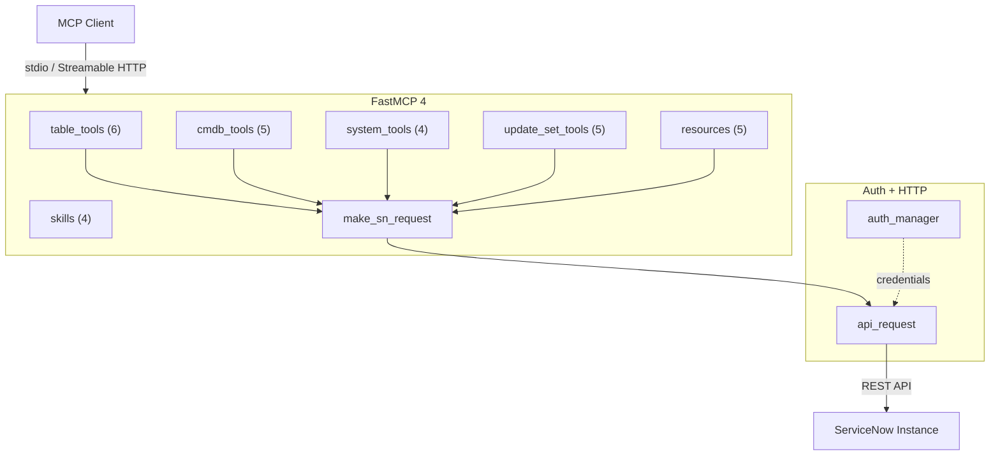

# Architecture



Built with [FastMCP 4](https://gofastmcp.com): it speaks both the stateless MCP 2026-07-28 protocol and the legacy handshake, negotiated per connection.

## Mounting it in your own server

The server is a building block: mount it into your own FastMCP server and it keeps its read-only mode, identifier and query validation and audit log. FastMCP does not forward a mounted server's instructions and prefixes its URIs, so pass the rendered ones on:

```python
from fastmcp import FastMCP
from servicenow_mcp.server import mcp as servicenow, render_instructions

app = FastMCP("orchestrator", instructions=render_instructions("snow"))
app.mount(servicenow, namespace="snow")  # tools snow_*, resources skill://snow/…
```

To mount it without the skills, call `init_services()` with a `ServerConfig(skills=False)` before the first `import servicenow_mcp.resources` (the module reads the switch once, when it is imported) and pass `render_instructions(skills=False)`.
